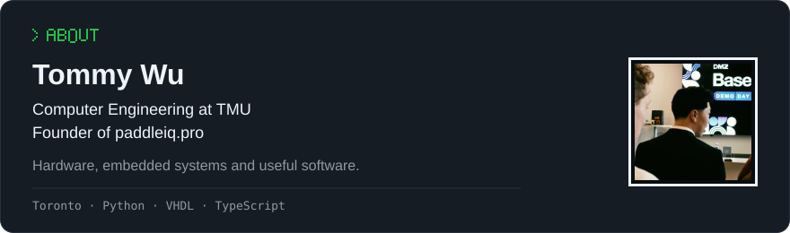
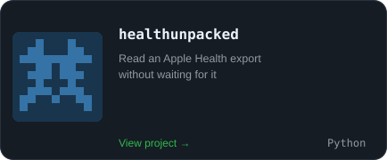
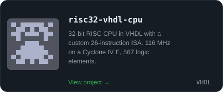
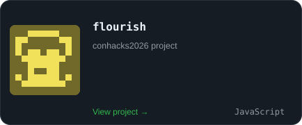
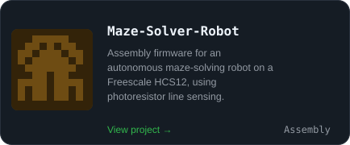
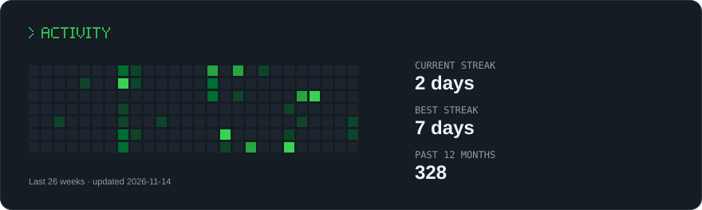

Computer Engineering @ TMU · Founder @ paddleiq.pro

[GitHub](https://github.com/TommyWu1) · [Portfolio](https://tommywu.dev/)

Project links and descriptions

- [healthunpacked](https://github.com/TommyWu1/healthunpacked) — Read an Apple Health export without waiting for it
- [risc32-vhdl-cpu](https://github.com/TommyWu1/risc32-vhdl-cpu) — 32-bit RISC CPU in VHDL with a custom 26-instruction ISA. 116 MHz on a Cyclone IV E, 567 logic elements.
- [flourish](https://github.com/DavidWu5/flourish) — conhacks2026 project
- [Align](https://github.com/jerryzhang04/align) — Voice-enabled posture coach for iPhone. Four-view scans, pose measurements and spoken guidance.

GitHub data updated 2026-11-14. Room shows a stylized night scene; terminal displays recent public commits.
